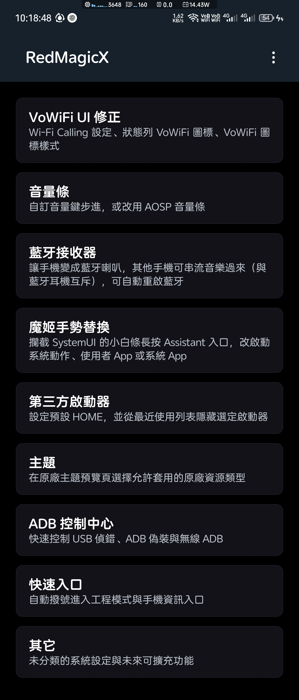
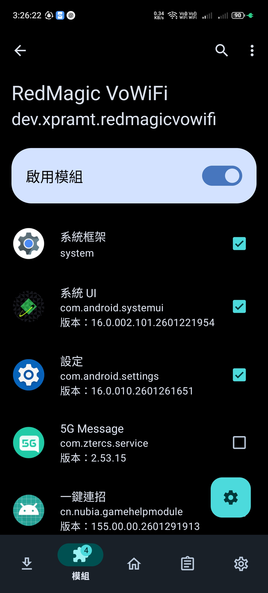
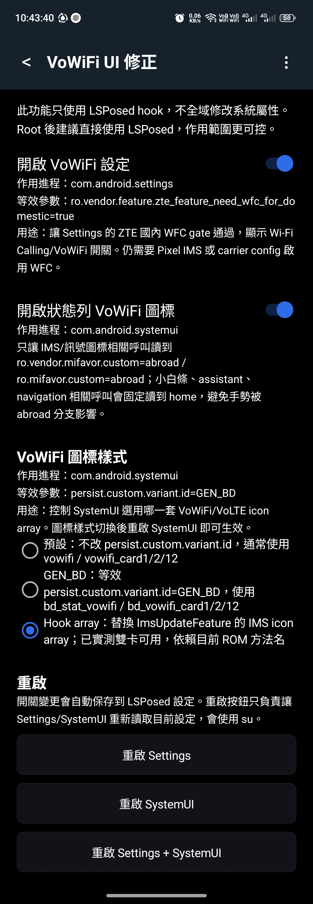
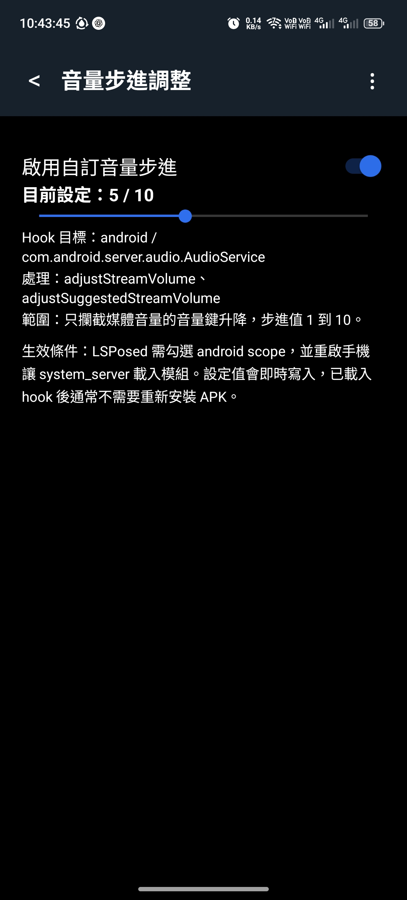
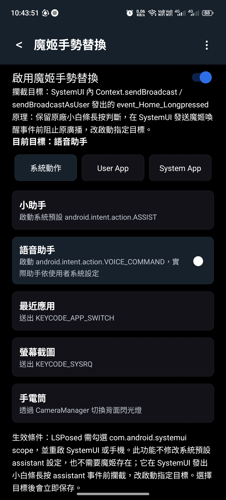
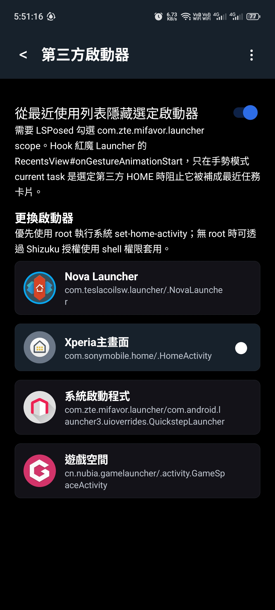

# RedMagicX

[English](README.md) | [繁體中文](README_TW.md)

RedMagicX is an unofficial RedMagic / Nubia tweak app for LSPosed, root, and Shizuku workflows. It mainly improves or solves China ROM UI behavior: VoWiFi UI, media volume-key step size, Bluetooth receiver mode, bottom gesture-bar assistant redirection, third-party launcher control, ADB control, and quick access to engineering mode and phone information.

Current version: `0.5.0`

Tested device: RedMagic / Nubia NX809J China ROM. Other RedMagic / Nubia models have not been tested, but may work if their ROM uses the same ZTE classes and properties.



## Table of Contents

- [Installation](#installation)
- [LSPosed Scopes](#lsposed-scopes)
- [Features](#features)
  - [VoWiFi UI Fix](#vowifi-ui-fix)
  - [Volume Step Control](#volume-step-control)
  - [Bluetooth Receiver](#bluetooth-receiver)
  - [Assistant Gesture Redirect](#assistant-gesture-redirect)
  - [Third-Party Launcher](#third-party-launcher)
  - [ADB Control Center](#adb-control-center)
  - [Quick Entry](#quick-entry)
- [KernelSU Module: Hi-Res Unlocker](#kernelsu-module-hi-res-unlocker)
- [Build](#build)
- [Notes](#notes)

## Installation

Download the APK from [GitHub Releases](https://github.com/XPRAMT/RedMagicX/releases) and install it directly on the phone.

For VoWiFi carrier capability, install [Pixel IMS](https://github.com/kyujin-cho/pixel-volte-patch) first and use it to enable VoWiFi. RedMagicX mainly fixes China ROM UI behavior: the missing Wi-Fi Calling / VoWiFi Settings toggle and status-bar VoWiFi icon behavior.

Root is used only for actions that execute shell commands, such as restarting Settings/SystemUI and applying the default launcher when Shizuku is not used.


Select RedMagicX scopes in LSPosed:



### Power Management (required)

In RedMagicOS system Power Management (電源管理), open RedMagicX and set Auto-start (自行啟動), Associated start (連帶啟動) and Background running (背景執行) all to Allow (允許).

Otherwise, after a reboot the third-party launcher does not take effect automatically (Home goes back to the stock launcher), and wireless ADB does not start automatically.

Once allowed, RedMagicX restores these about 25 seconds after boot:

- Wireless ADB is re-enabled on the last saved port (if it is enabled on the ADB page).
- The selected third-party launcher is re-applied (the default Home is switched to the stock launcher and back, so the Home gesture uses the selected launcher). Home may still go to the stock launcher in the first few seconds after boot.

## LSPosed Scopes

Enable RedMagicX in LSPosed, then select scopes based on the features you use:

| Feature | Required scope |
|---|---|
| VoWiFi UI Fix | `com.android.settings`, `com.android.systemui` |
| Volume Step Control | `android` / System Framework |
| Bluetooth Receiver | `com.android.bluetooth` |
| Assistant Gesture Redirect | `com.android.systemui` |
| Third-Party Launcher recent-task hiding | `com.zte.mifavor.launcher` |

Settings are saved with LSPosed `XSharedPreferences`. If a target process already loaded before a setting change, restart the related process from the app when available; if the target is `android`, reboot the phone.

## Features

### VoWiFi UI Fix

Uses LSPosed hooks only. It does not globally modify system properties with `resetprop`.



| Switch | Scope | What it changes |
|---|---|---|
| Enable VoWiFi settings | `com.android.settings` | Makes Settings read `ro.vendor.feature.zte_feature_need_wfc_for_domestic=true`, so the Wi-Fi Calling / VoWiFi toggle appears. Pixel IMS or carrier config is still required to enable WFC capability. |
| Enable status-bar VoWiFi icon | `com.android.systemui` | Makes IMS/status-icon code read `ro.vendor.mifavor.custom=abroad` / `ro.mifavor.custom=abroad`, while navigation and assistant code stays on `home` to avoid breaking the gesture bar. |
| VoWiFi icon style = GEN_BD | `com.android.systemui` | Makes SystemUI read `persist.custom.variant.id=GEN_BD`, selecting BD-style VoWiFi resources. Restart SystemUI after changing. |
| VoWiFi icon style = Hook array | `com.android.systemui` | Replaces the IMS icon array result with the BD array. Tested working with dual SIM on the current NX809J ROM; it depends on the current ROM method name. |

The **Open WiFi Calling settings** button directly opens RedMagic Settings `WifiCallingSettingsActivity` and does not require root or Shizuku.

VoWiFi icon style comparison:

Default style uses `statusbar_vowifi.svg`:


BD style uses `bd_stat_vowifi.svg`:


### Volume Step Control

Customizes how many media-volume levels one hardware volume-key press changes.



- Range: `1` to `10`
- Scope: `android` / System Framework
- Hook target: `com.android.server.audio.AudioService`
- Hooked behavior: media-volume key up/down step size
- Instant volume-change notifications (on by default): background volume-panel apps (such as Ultra Volume) receive volume-change notifications immediately instead of being delayed about 0.5 s by the system; only affects volume-change notifications (`VOLUME_CHANGED_ACTION`); reboot required after changing
- Activation: enable the switch, set the step value, then reboot so system_server loads the LSPosed module

### Bluetooth Receiver

Turns the phone into a Bluetooth speaker: another phone pairs with it and streams audio to it. The phone can only take one Bluetooth audio role at a time, because the Android Bluetooth stack on the tested phone did not run the headphone role (A2DP source) and the speaker role (A2DP sink) together reliably. In receiver mode Bluetooth headphones cannot connect.

- **Bluetooth receiver mode** switch (default off). The setting is kept across reboots until you switch it off.
- **Auto restart Bluetooth** switch (default off). When on, every mode switch turns Bluetooth off and on by itself, so the new mode takes effect immediately. It needs root or Shizuku, and it never turns Bluetooth on if it was off. When off, turn Bluetooth off and on yourself after switching. A **Restart Bluetooth now** button does the same on demand.
- Status line: shows the mode the running Bluetooth process reports next to the configured mode, so you can see whether a switch has taken effect.
- Scope: `com.android.bluetooth`
- Hook targets: `A2dpSinkService.isEnabled()` and `A2dpService.isEnabled()`, which decide the profile services when the Bluetooth process starts (so a mode change needs a Bluetooth restart). Normal mode installs no role hooks.
- Use: switch the mode on and let Bluetooth restart, open Settings > Bluetooth > Pair new device on this phone, then pair and play from the other phone. Switch it off and restart Bluetooth to use headphones again.
- Limits: only SBC and AAC can be received (the stack has no LDAC, aptX or LHDC decoder). The other phone still sees a phone-class device. Tested on the NX809J with one sending phone only.

### Assistant Gesture Redirect

Redirects the RedMagic bottom gesture-bar long-press assistant event.



Targets:

- System actions: Assistant, voice assistant, recents, screenshot, flashlight
- User apps
- System apps

This feature does not change Android's default assistant setting. It intercepts the SystemUI broadcast path before the original RedMagic assistant target opens, then launches the selected target.

### Third-Party Launcher

Sets a selected launcher as the default HOME activity and can hide that launcher from RedMagic's recent apps list in gesture mode.



- Change launcher: uses Android's own `cmd package set-home-activity --user 0 <component>`.
- Permission path: root is tried first; if root is unavailable, Shizuku shell permission is used.
- Hide from recents: requires LSPosed scope `com.zte.mifavor.launcher`. It hooks RedMagic Launcher `RecentsView#onGestureAnimationStart`; only when gesture mode current task is the selected third-party HOME, it prevents that task from being inserted as a recent-task card.

### ADB Control Center

All ADB Control Center actions require root.

- Enable ADB: controls the Developer options USB debugging setting through `adb_enabled=1`.
- Spoof ADB status: writes `adb_enabled=2`. Android treats values above zero as enabled, while some apps that check only for `adb_enabled == 1` may treat it as disabled. It does not bypass apps that check other debugging state.
- Enable wireless ADB: sets the TCP port and restarts `adbd`. The switch is saved as user intent rather than mirroring the current daemon state. When ADB is enabled, RedMagicX checks the daemon every five seconds and restores wireless ADB with the saved port when needed.
- Allow ADB install: controls RedMagic Developer options `adb_install_enabled=1`, which is required before `adb install` can install APKs.

### Quick Entry

Provides automatic dialing for RedMagic engineering mode and a direct phone-information shortcut.

- Unlock engineering mode: automatically enters `*983*673636#` in the stock RedMagic dialer. This is normally needed only once.
- Enter engineering mode: automatically enters `*983*0#` so EMode performs its required initialization and loads the complete test menu.
- Dialer validation: verifies that `com.android.contacts/.activities.DialtactsActivity` exists and is enabled before injecting input. Missing or failed dialer launches stop immediately instead of reporting success.
- Permission path: root is tried first; when root is unavailable, Shizuku shell permission is used.
- Phone information: directly opens `com.android.phone/.settings.RadioInfo` without root or Shizuku on the tested NX809J ROM.

## KernelSU Module: Hi-Res Unlocker

A separate KernelSU module in [`ksu-hires-unlocker/`](ksu-hires-unlocker). It is not an LSPosed module and not part of the APK.

On the stock ROM the system mixer is locked at 48 kHz, so every track is resampled to 48 kHz before it reaches Bluetooth, wired headphones or USB audio. This module lets the mixer follow the sample rate of the audio file.

Supports the RedMagic NX809J on Android 16: the installer checks the model and the Android version and refuses to install on anything else. It was developed and tested on RedMagicOS 11.0.22 (incremental `20260204.095106`); other builds of the same model are untested. The installer finds the patch sites by their instruction bytes and aborts if they are not found exactly as expected, and at boot the module disables itself if the system files it was built from have changed (for example after an OTA); install it again afterwards.

| Part | Change |
|---|---|
| `audio_module_config_primary.xml` (audio HAL config) | One deep-buffer mix port per sample rate: 44.1 / 48 / 88.2 / 96 kHz on Bluetooth A2DP, and additionally 176.4 / 192 kHz on wired headphones and USB audio. |
| `libaudiopolicymanagerdefault.so` (2 bytes) | AOSP only compares the sample rate for requests above 48 kHz, so 44.1 / 48 kHz tracks land on whichever output opened first. The patch scores every request, so each track picks the port with its own rate. |
| `libaudiocorehal.qti.so` (2 sites, 32 bytes each) | The deep-buffer size is 40 ms of frames, which is 1764 / 3528 frames at 44.1 / 88.2 kHz, not a multiple of 16. AudioFlinger rounds up to 16 and splits every write in two, which crackles. The patch rounds the HAL size up to a multiple of 16. |
| `audioserver` (AudioFlinger, 1 instruction) + `ro.audio.flinger_standbytime_ms` | AudioFlinger keeps every output thread connected to Bluetooth in a standby wait of at least 3 s. While an old thread waits for standby, the output backend stays busy, so a stream with a different sample rate cannot start and the HAL drops its first writes (about 3 s of silence). The patch removes the 3 s floor (one branch instruction) and the module sets the standby delay to 500 ms at boot, for all output threads. |

Comparison of the three outputs (measured on the phone):

| | Bluetooth (A2DP) | Wired 3.5 mm headphones | USB audio (DAC) |
|---|---|---|---|
| Sample rates the mixer follows | 44.1 / 48 / 88.2 / 96 kHz | 44.1 / 48 / 88.2 / 96 / 176.4 / 192 kHz | 44.1 / 48 / 88.2 / 96 / 176.4 / 192 kHz |
| Ports above 96 kHz | No (LDAC tops out at 96 kHz) | Yes | Yes |
| What sets the final output rate | The Bluetooth codec configuration: the LDAC DSP backend stays at 96 kHz on the tested phone | The PAL headphone device follows the stream rate | The PAL `USB_AUDIO-RX` backend follows the stream rate, limited to what the DAC supports (tested DAC: 32 to 384 kHz, 16 / 24 / 32 bit) |
| Sample-rate change at a song boundary | About 0.4 to 0.5 s of the new song is muted if the previous stream ended less than about 0.5 s earlier (about 2.7 s before v0.8.0); nothing is lost with a longer gap or at the same rate | Less than 0.3 s of the new song is muted (about 2 s before v0.8.0) | No delay seen (four back-to-back combinations, no start errors) |
| Standby delay | 500 ms (was 3 s) | 500 ms (was 2 s) | 500 ms (was 2 s) |
| 44.1 / 88.2 kHz crackle fix | Listening test clean | HAL write jitter (std) 18.7 ms to 2.0 ms at 44.1 kHz; listening clean | Jitter (std) 4.2 to 4.9 ms at every rate; listening clean |
| How it was checked | Mixer thread of each track, LDAC backend log, listening | Mixer thread, PAL device configuration, jitter statistics, listening | Mixer thread, PAL USB media configuration, jitter statistics, back-to-back playback, listening |
| Not verified | Codecs other than LDAC | The DAC clock itself | The DAC clock itself (ADSP offload hides it from ALSA); only one DAC tested |

Limits:

- The speaker and earpiece stay at 48 kHz (fixed hardware backend, smart amplifier).
- The Bluetooth and wired output backends run one sample rate at a time. If a different rate starts while the previous stream is still playing (cross-fade, preloading the next track), the new stream stays muted until the old one has finished plus the 0.5 s standby, because the HAL drops the writes while the start is retried.
- The 0.5 s standby is global. The Bluetooth output path holds about 0.35 to 0.44 s of audio, so the delay should not be set much lower (the end of a track could be cut). After a pause longer than 0.5 s playback starts about 0.1 s later (HAL restart), and short sounds on the speaker start about 30 to 50 ms later; nothing is lost. The change is made in `audioserver`; if you want to avoid it, use the v0.7.0 release (everything except the standby change).
- Apps cannot ask for more than 192 kHz through `AudioTrack`; the 384 kHz `hifi_playback` output that exists on USB is unchanged.
- Only one USB DAC (Sony Audio) was tested.
- When 3.5 mm headphones and a USB DAC are connected together, Android plays through the 3.5 mm headphones.

Install:

1. Download `bt_hires_mixer_v0.8.0.zip` from [GitHub Releases](https://github.com/XPRAMT/RedMagicX/releases) (tag `hires-mixer-v0.8.0`).
2. Install it in the KernelSU manager and reboot.
3. If there is no sound after a reboot, disable the module in the KernelSU manager (or boot into KernelSU safe mode) and reboot again.

To update an installed module the installer reuses the backup of the stock config it keeps in `/data/adb/bt_hires_mixer_stock/`. If that backup is missing (upgrading from a version without it), disable the module, reboot, and install again.

The zip contains no vendor files: the installer copies the phone's own libraries, patches a few bytes, generates the mix-port config from the phone's own config, and verifies the result.

The sample-rate gate in AOSP was reported upstream as [Issue Tracker 578577149](https://issuetracker.google.com/issues/578577149) with a work-in-progress change [4396965](https://android-review.googlesource.com/c/platform/frameworks/av/+/4396965).

Use at your own risk. This is an unofficial project and is not affiliated with RedMagic, Nubia, ZTE, or Qualcomm.

## Build

```powershell
& 'C:\Users\XPRAMT\.gradle\wrapper\dists\gradle-8.13-bin\5xuhj0ry160q40clulazy9h7d\gradle-8.13\bin\gradle.bat' -p 'D:\Android\ZTE\VoWiFI\lsposed-redmagic-vowifi' assembleDebug
```

APK output:

```text
app\build\outputs\apk\debug\app-debug.apk
```

## Notes

- The module declares `xposedminversion=93` and `xposedsharedprefs=true`.
- Shizuku is used for applying the default launcher and operating engineering-mode quick entry without root.
- This is an unofficial project and is not affiliated with RedMagic, Nubia, or ZTE.
